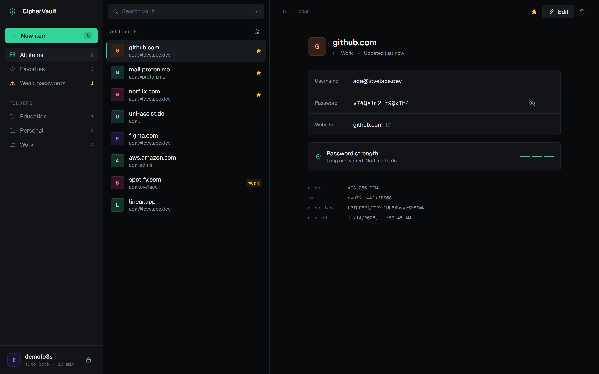
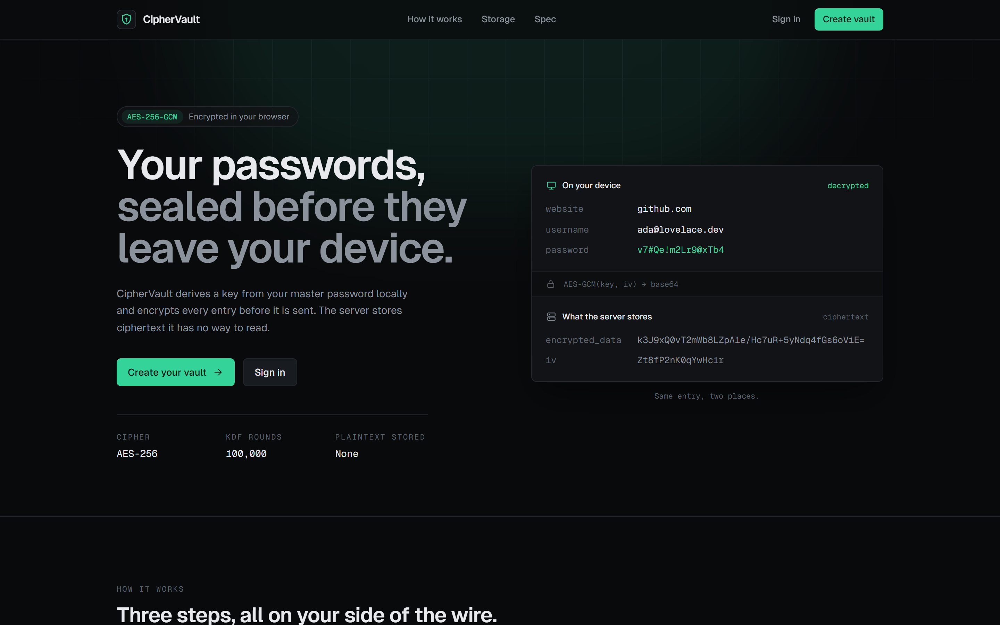
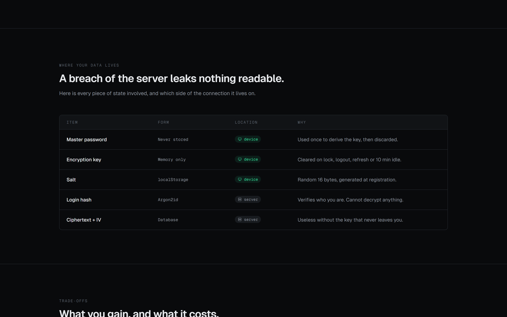
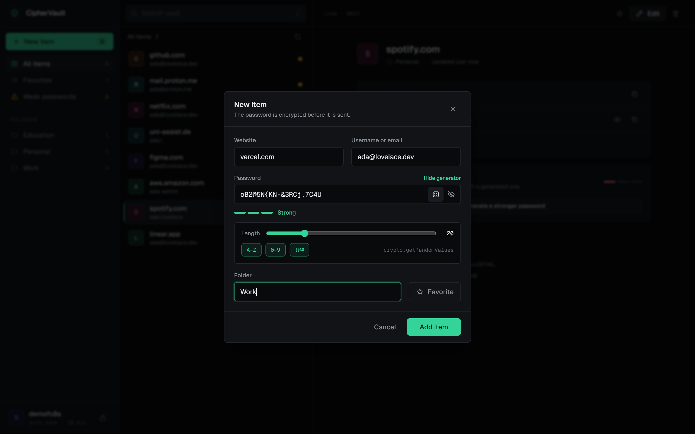
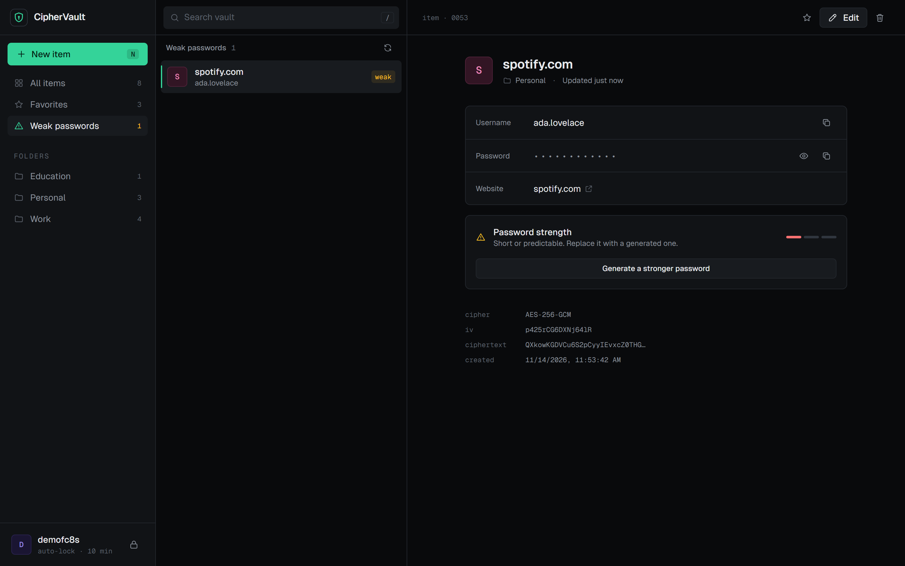
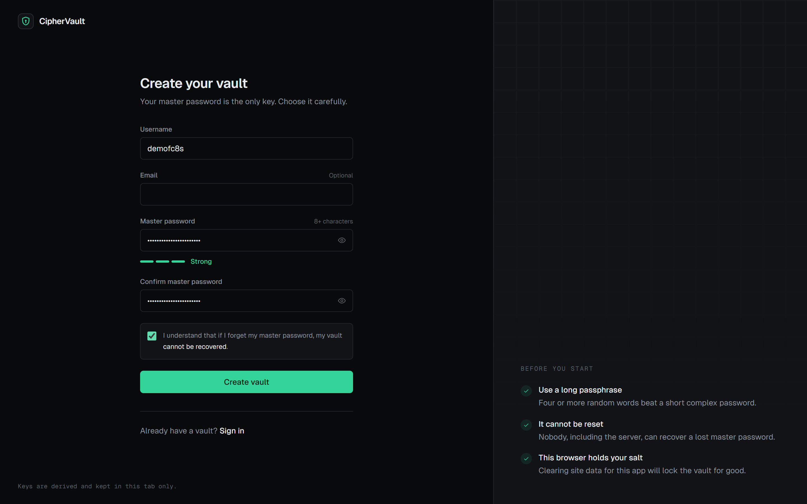
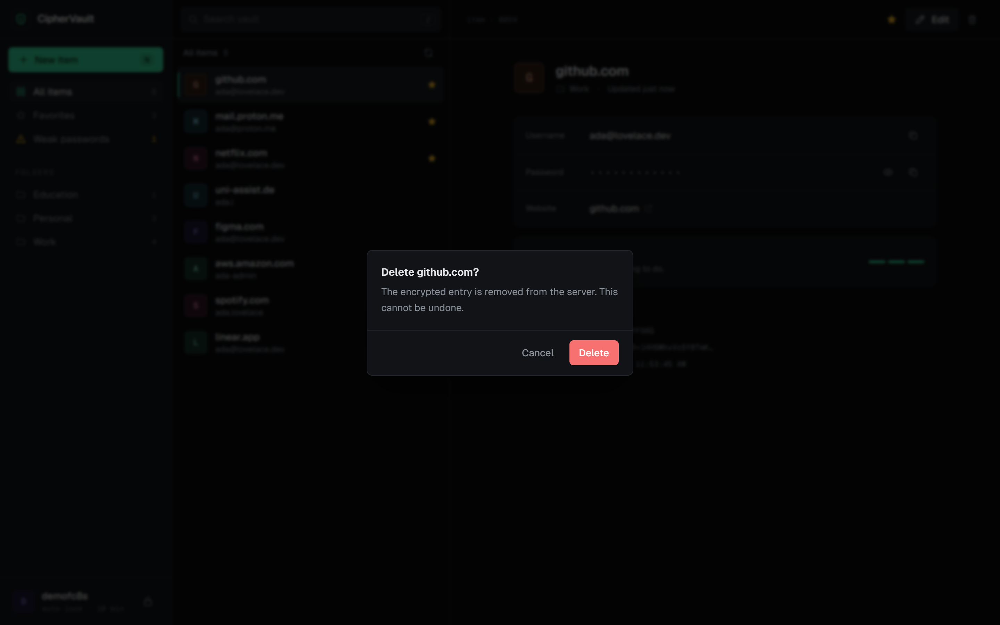
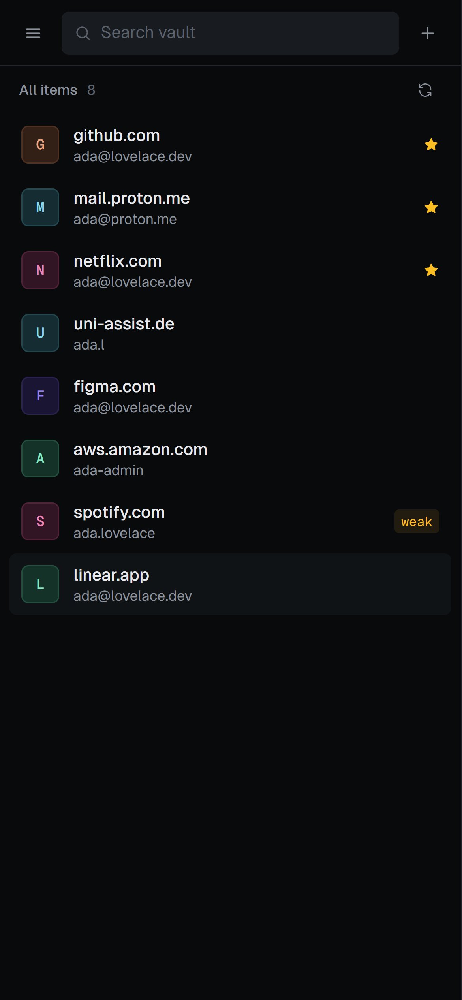
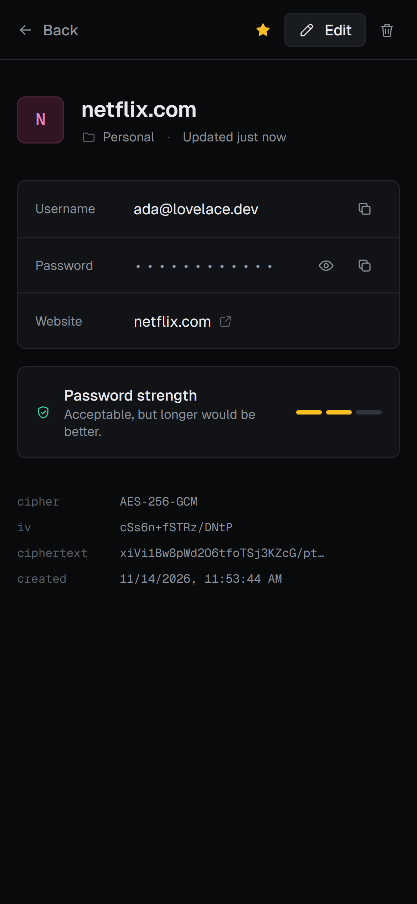
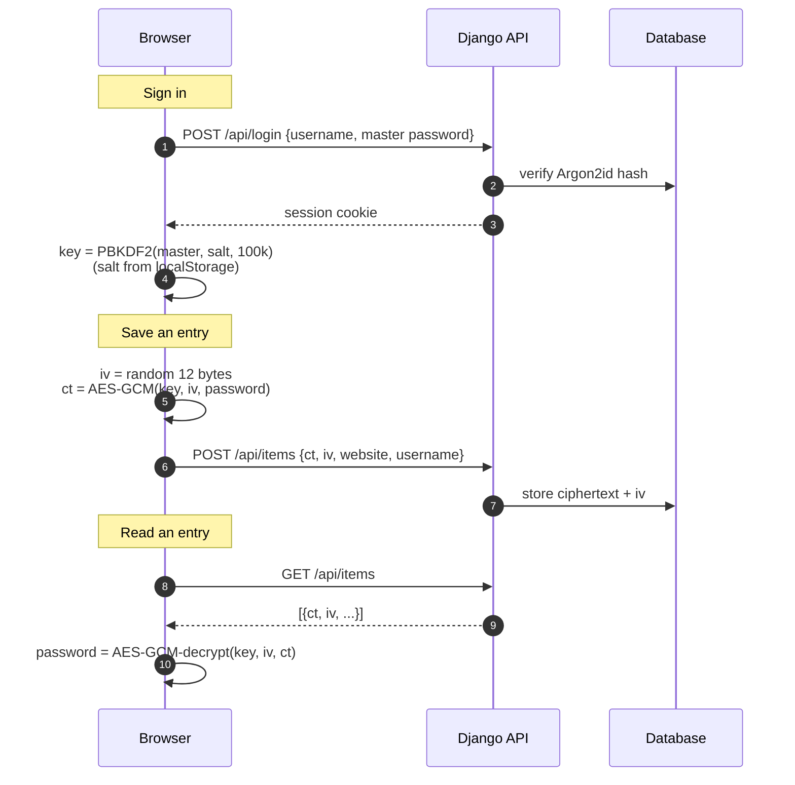

<h1 align="center">CipherVault</h1>

<p align="center">
  A zero-knowledge password manager. Every secret is encrypted in the browser with AES-256-GCM<br>
  before it is sent, so the server only ever stores ciphertext it cannot read.
</p>

<p align="center">
  
  
  
  
  
</p>

<p align="center">
  
</p>

---

## Contents

- [Screenshots](#screenshots)
- [Features](#features)
- [How it works](#how-it-works)
- [Security model](#security-model)
- [Getting started](#getting-started)
- [Project structure](#project-structure)
- [API](#api)
- [Challenges along the way](#challenges-along-the-way)
- [Roadmap](#roadmap)

## Screenshots

<table>
  <tr>
    <td width="50%"></td>
    <td width="50%"></td>
  </tr>
  <tr>
    <td align="center"><sub>Landing page</sub></td>
    <td align="center"><sub>Where every piece of state lives</sub></td>
  </tr>
  <tr>
    <td></td>
    <td></td>
  </tr>
  <tr>
    <td align="center"><sub>Item editor with the built-in generator</sub></td>
    <td align="center"><sub>Weak password audit, scored locally</sub></td>
  </tr>
  <tr>
    <td></td>
    <td></td>
  </tr>
  <tr>
    <td align="center"><sub>Create a vault</sub></td>
    <td align="center"><sub>In-app confirmation for destructive actions</sub></td>
  </tr>
</table>

<p align="center">
  
  &nbsp;&nbsp;
  
</p>

## Features

**Security**
- Client-side AES-256-GCM encryption through the Web Crypto API, with a fresh 96-bit IV per entry
- Key derived from the master password with PBKDF2-SHA256 (100,000 iterations) and kept in memory only, as a non-extractable `CryptoKey`
- Server-side login hashing with Argon2id, plus rate limiting on login (5/min)
- Auto-lock after 10 minutes of inactivity; refreshing the page also drops the key

**Vault**
- Three-pane layout: smart views and folders, searchable list, detail pane
- Instant search across website, username and folder
- Favorites, folders, and a **Weak passwords** view. Strength is computed in the browser after decryption, because the server never sees plaintext.
- Separate one-click copy for username and password; reveal on demand
- Password generator backed by `crypto.getRandomValues` (8–64 characters, selectable character classes)
- Keyboard shortcuts: <kbd>/</kbd> search, <kbd>N</kbd> new item, <kbd>↑</kbd>/<kbd>↓</kbd> move through the list, <kbd>Esc</kbd> clear
- Responsive: the sidebar becomes a drawer and the detail pane a full-screen sheet on small screens

## How it works



The master password is sent to the server at registration and at login, over the session's connection, so it can be hashed and checked with Argon2id. It is never stored in plaintext, and the encryption key derived from it never leaves the browser.

## Security model

| State | Form | Lives on | Notes |
|---|---|---|---|
| Master password | never stored in plaintext | device | Derives the key locally; also sent at login so the server can check its hash |
| Encryption key | non-extractable `CryptoKey` | device (memory) | Cleared on lock, logout, refresh or 10 min idle |
| Salt | 16 random bytes | device (`localStorage`) | Generated at registration |
| Login hash | Argon2id | server | Proves identity; cannot decrypt anything |
| Ciphertext + IV | Base64 | server | Useless without the key |

| Threat | Mitigation | Status |
|---|---|---|
| Database breach | Only ciphertext and Argon2id hashes are stored | Mitigated |
| Server compromise | Server never holds the encryption key | Mitigated |
| Brute-force login | Rate limiting + Argon2id cost | Mitigated |
| Tampered ciphertext | GCM authentication tag fails to verify | Mitigated |
| Identical passwords | Unique random IV per entry | Mitigated |
| Network eavesdropping | No plaintext secrets in transit; use HTTPS in production | Requires HTTPS |
| XSS | React escaping; no CSP configured yet | Partial |
| Phishing / weak master password | User responsibility | Not covered |

**Trade-offs.** There is no password recovery. The salt lives in the browser that created the vault, so clearing site data, or switching browsers, makes the vault unrecoverable. This is an educational project and has not been audited; do not use it for real secrets.

## Getting started

**Requirements:** Python 3.12+, Node.js 18+.

### 1. Backend (Django, port 8000)

```bash
cd backend
python -m venv .venv
# Windows: .venv\Scripts\activate    macOS/Linux: source .venv/bin/activate
pip install -r ../requirements.txt
python manage.py migrate
python manage.py runserver
```

> `requirements.txt` includes `psycopg[binary]` for PostgreSQL. The default configuration uses SQLite.

### 2. Frontend (Next.js, port 3000)

```bash
cd frontend
npm install --legacy-peer-deps
npm run dev
```

Open <http://localhost:3000>, create a vault, then sign in.

The API base URL defaults to `http://localhost:8000/api`. To point the frontend somewhere else, set it in `frontend/.env.local`:

```bash
NEXT_PUBLIC_API_URL=https://your-api.example.com/api
```

> `--legacy-peer-deps` is needed because `eslint-config-next@16` declares a peer dependency on ESLint 9, while the project pins ESLint 8.

## Project structure

```
backend/
  config/                Django settings, URLs, WSGI/ASGI
  passwords/             models, serializers, views, CSRF-exempt session auth
frontend/
  app/
    page.js              landing page
    login/  register/    auth pages
    dashboard/           vault (state, filtering, shortcuts, auto-lock)
  components/
    vault/               Sidebar, EntryList, EntryDetail, EntryEditor
    AuthShell.js         shared auth layout and form fields
    ui.js                logo, dialog, toast, strength meter, monogram
    icons.js             icon set
  lib/
    crypto.js            PBKDF2 key derivation + AES-GCM encrypt/decrypt
    password.js          strength scoring + CSPRNG generator
    api.js               axios instance
    store.js             in-memory auth store (Zustand)
```

## API

All item endpoints require a session cookie.

| Method | Endpoint | Description |
|---|---|---|
| `POST` | `/api/register/` | Create an account (`username`, `email`, `password`) |
| `POST` | `/api/login/` | Start a session |
| `POST` | `/api/logout/` | End the session |
| `GET` | `/api/items/` | List items. Optional `search`, `folder`, `favorite=true` |
| `POST` | `/api/items/` | Create an item (`encrypted_data`, `iv`, `website`, `username`, `folder`, `favorite`) |
| `PUT` / `PATCH` | `/api/items/{id}/` | Update an item |
| `DELETE` | `/api/items/{id}/` | Delete an item |
| `GET` | `/api/items/folders/` | Folder names with item counts |

## Challenges along the way

- **Circular imports with a custom auth class.** Defining `CsrfExemptSessionAuthentication` inside `views.py` triggered an import cycle during settings load. Moving it to its own `authentication.py` fixed it.
- **CORS with credentials.** `CorsMiddleware` has to come before `CommonMiddleware`, and cookies need `CORS_ALLOW_CREDENTIALS`, explicit `CORS_ALLOWED_ORIGINS` and `CSRF_TRUSTED_ORIGINS`.
- **Async Web Crypto.** Every crypto call returns a promise. Deriving the key once and caching it in memory avoids re-running PBKDF2 for every entry.
- **Where to keep the salt.** Server, `localStorage`, or derived from the username. `localStorage` keeps it random and per-user, at the cost of tying the vault to one browser.
- **IV handling.** GCM IVs must be unique but not secret, so they are stored next to the ciphertext.
- **Scoring strength without plaintext on the server.** The original weak-password filter was sent to the API, which cannot see passwords, so it never matched anything. Strength is now computed in the browser right after decryption, and the plaintext is discarded immediately.
- **Argon2 on Windows.** `argon2-cffi` needs a prebuilt wheel or the Visual C++ Build Tools.

## Roadmap

- [x] Zero-knowledge encryption architecture
- [x] Registration, login, rate limiting
- [x] Item CRUD, folders, favorites, search
- [x] Auto-lock after inactivity
- [x] Password strength meter and weak-password view
- [x] Configurable password generator
- [ ] Store the salt server-side so vaults work across browsers
- [ ] Content Security Policy
- [ ] Two-factor authentication (TOTP)
- [ ] Breached-password check (Have I Been Pwned, k-anonymity)
- [ ] Encrypted export / import
- [ ] WebAuthn unlock
